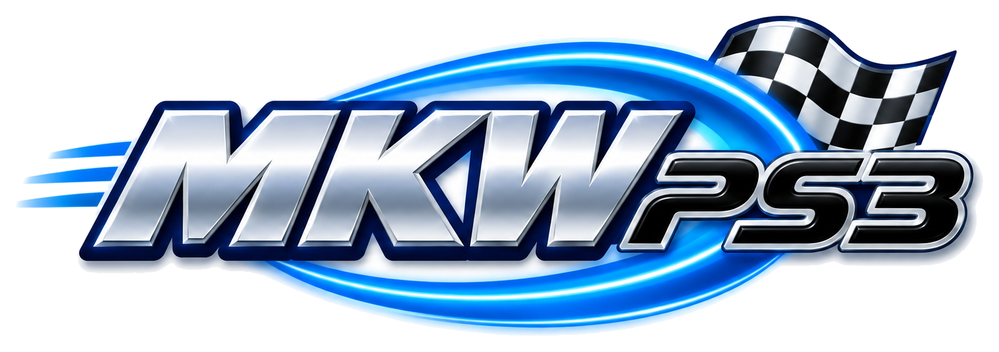
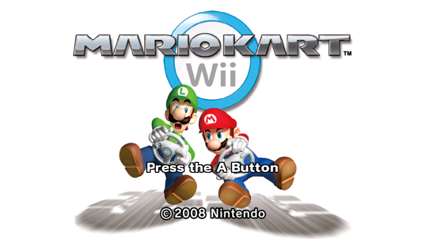
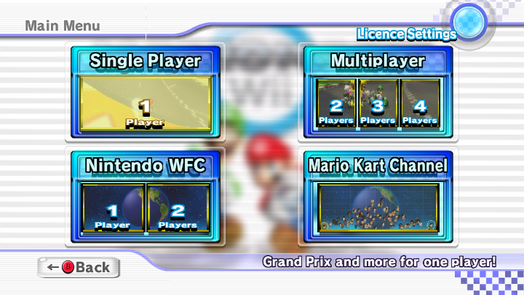
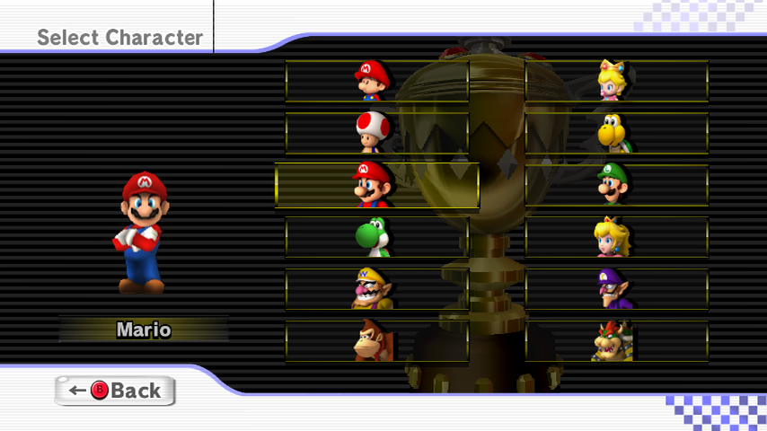
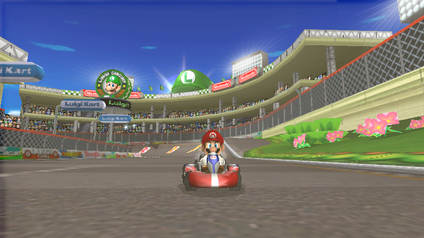
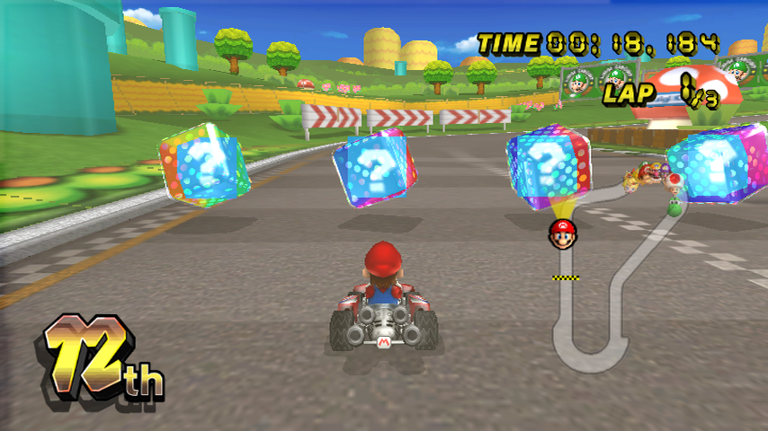

<p align="center">
  
</p>

<p align="center">
  <b>A native PS3 port of Mario Kart Wii, made with static recompilation.</b>
</p>

<p align="center">
  <a href="LICENSE"></a>
  
  
</p>

---

> [!WARNING]
> **This project is discontinued and the repo is archived.** I've stopped working on it,
> and issues and pull requests are closed. Everything below still works as described, but
> nothing will be fixed or updated. If you want to carry it on, fork it; it's GPL-3.0.
> [Why it stopped](#why-it-stopped) has the details, and
> [docs/LESSONS.md](docs/LESSONS.md) has everything we learned.

It's built on [WiiCompiled](https://github.com/patchzyy/Wiicompiled), the recompiler
behind the PC port, with everything the game expects from a Wii rebuilt around the PS3's
hardware: the RSX does the drawing, the SPUs take the vertex work and the audio mix, and
the recompiler has picked up a few tricks for the Cell along the way.

> [!IMPORTANT]
> There's no Nintendo code, no game files and nothing from the disc in this repo,
> and there never will be. You need your own clean dump of the **PAL** version of
> the game (`RMCP01`). The build runs on your machine, against your disc, and the
> package it makes has your copy of the game inside it, so please don't share it.

## Screenshots

<p align="center">
  
  
  
  
</p>

<sub>Straight off a real PS3 with the app's own screenshot command. The game renders at 720x480; these are shown at 16:9, same as on a widescreen TV.</sub>

## Where it's at

This is where it stood when work stopped.

| | |
| --- | --- |
| ✅ Boots, intro movie, menus | All there, and they look right |
| ✅ Grand Prix | 12-kart races, the most tested part |
| ✅ Sound and music | Mixed on the console in real time |
| ✅ Saves and licences | Kept on the PS3's hard drive |
| ✅ DualShock 3 | Presented to the game as a GameCube controller |
| ⚠️ Speed | About **40fps** in a full race, so the race runs at roughly two-thirds speed. It never reached full speed |
| ✅ Karts and characters | Properly lit and coloured now (they used to be dark silhouettes) |
| ⚠️ Some effects | Mii heads come out as black squares, so the crowd looks a bit odd. There'll be other bits that aren't quite right yet too |
| ❓ VS, Time Trials, Battle | Should work, but they've had a lot less testing |
| ❓ Split-screen | Up to four pads are wired up, but it hasn't really been tested |
| ❌ Online | Not hooked up |
| ❌ Wii Remote, wheel, nunchuk | DualShock 3 only for now |
| ❌ NTSC and other regions | PAL only, for now |

Here's a race as it looks today:

<p align="center">
  
</p>

## Getting it running

### What you need

- **A PS3 that runs homebrew.** I've been testing on CFW (Evilnat 4.93 PEX). HEN should
  work in theory but nobody's tried it yet, so let me know if you do.
- **Your own Mario Kart Wii disc image, PAL (`RMCP01`), unmodified.** ISO, WBFS, RVZ,
  WIA, CISO and GCZ are all fine.
- **A computer with [Docker Desktop](https://www.docker.com/products/docker-desktop/)**
  (Windows, macOS or Linux). Give Docker at least 8 GB of RAM if you can, and have about
  25 GB of disk free.
- **A bit of patience the first time.** The first build takes anywhere from 30 minutes
  to an hour and a half depending on your machine. After that it's much quicker.

### 1. Get the code

```sh
git clone https://github.com/rooklz/mkwps3.git
cd mkwps3
```

Or hit the green **Code** button above, then **Download ZIP**, and unzip it somewhere.

### 2. Build your package

**Windows** (in PowerShell, from the `mkwps3` folder):

```powershell
powershell -ExecutionPolicy Bypass -File .\build.ps1 "D:\Games\Mario Kart Wii.wbfs"
```

**macOS or Linux:**

```sh
./build.sh ~/Games/MarioKartWii.wbfs
```

That's it. It checks your disc, pulls the game apart, translates it, compiles it for the
PS3 and packs it all into `out/MKWP00001.pkg`. If something goes wrong it'll tell you
what, and [docs/BUILDING.md](docs/BUILDING.md) has more detail.

### 3. Install it on the PS3

1. Copy `out/MKWP00001.pkg` to the root of a USB stick (FAT32).
2. Plug it into the PS3 and go to **Game → Package Manager → Install Package Files →
   Standard** (the wording varies a bit between CFWs).
3. Pick `MKWP00001.pkg` and let it install. It's about 2.7 GB, so it takes a few minutes.

If you've got webMAN MOD or multiMAN you can install it from there too, or drop it in
`/dev_hdd0/packages/` over FTP.

### 4. Play

**Mario Kart Wii** shows up in the Game column. Off you go.

## Controls

The game sees your DualShock 3 as a GameCube controller, so it uses Mario Kart Wii's
GameCube layout.

| DualShock 3 | GameCube | In game |
| --- | --- | --- |
| Cross | A | Accelerate, confirm |
| Square | B | Brake and reverse, back |
| R1 or R2 | R | Drift and hop |
| L1 or L2 | L | Use item |
| D-pad | D-pad | Tricks and wheelies |
| Left stick | Control stick | Steer |
| Right stick | C-stick | |
| Circle | X | |
| Triangle | Y | |
| Select | Z | |
| Start | Start | Pause |

## Updating

Grab the latest code (`git pull`, or download the ZIP again) and run the build command
again. It only redoes what changed. Install the new package over the old one; your
saves stay put.

## FAQ

**Is this an emulator?**
No, the game's code is compiled for the PS3 before it runs. [How it works](docs/HOW-IT-WORKS.md)
has the details.

**Can't I just download a ready-made .pkg?**
No, and please don't share yours. Anything that runs would have Nintendo's game inside
it. That's the whole reason the build runs on your machine with your disc.

**Why only PAL?**
The translation is pinned to the exact PAL executable, same as WiiCompiled. Other regions
would need their own work, and a wrong-version disc gives you a subtly broken game,
so the build refuses anything that isn't a clean `RMCP01`.

**Why not 60fps?**
The PS3's main CPU core has to get through about eight million of the Wii's instructions
every frame, plus everything the Wii's other chips did for free. In a full race that's
about 21ms a frame, and it needs to be under 16.7ms for 60. Because the game counts time
in frames, it runs slower than on a Wii rather than dropping frames.

**Does it work on a Slim or Super Slim?**
It should. They've all got the same Cell and RSX inside. If yours can run homebrew,
give it a go and let me know.

**Online play?**
No.

**Retro Rewind and other mods?**
WiiCompiled can build Retro Rewind on PC, but that's not wired up on the PS3 yet.

**It crashed / froze / looks wrong.**
The repo is archived, so there's nowhere to report it any more. The log is at
`/dev_hdd0/tmp/mkwii-ps3.log` if you want to dig in yourself.

## How it works

The short version: the translator reads the game's PowerPC code and writes it out as
C++, about thirty thousand functions of it. That gets compiled for the PS3's Cell, and
runs against a runtime that stands in for the Wii's operating system and hardware.
Graphics go to the RSX, vertex work goes to the SPUs, and the audio is mixed on the
console the way the Wii's DSP would have.

There's a longer, still fairly readable version in
[docs/HOW-IT-WORKS.md](docs/HOW-IT-WORKS.md).

## Why it stopped

Full speed turned out to be out of reach. Even with the renderer switched off entirely,
the game's own code takes about 18.7ms a frame on the PS3's main core, against a 16.7ms
budget, and the profile is flat: no single hot spot left to fix. Every big idea got
measured. A native PowerPC-to-Cell backend came out 2.5 times slower than the C++
translation. Passing arguments in registers, moving audio to the SPUs and porting hot
functions each gained 0.1ms or less. A 30fps mode that draws every other frame got the
race to 0.93× speed, but some effects then ran at half rate. It also still wouldn't have
covered three- and four-player split-screen, which the Wii itself only runs at 30fps.

## Carrying it on

Fork it. [docs/BUILDING.md](docs/BUILDING.md) covers the developer setup: building
without Docker, pushing builds straight to the console over the network, and the
debugging tools. [CONTRIBUTING.md](CONTRIBUTING.md) has the ground rules the project ran
on, and [AGENTS.md](AGENTS.md) lists where everything lives.

Help is very welcome, especially from anyone who knows their way around the RSX or the SPUs.

## Credits

- **[WiiCompiled](https://github.com/patchzyy/Wiicompiled)**, the static recompiler and
  runtime this is all built on. None of this exists without it.
- **[Dolphin](https://github.com/dolphin-emu/dolphin)**, an endless reference for how
  the Wii actually behaves, and the source of the free DSP coefficient ROM and the
  WiiConnect24 defaults the build pulls in.
- **[PSL1GHT](https://github.com/ps3dev/PSL1GHT)** and
  **[ps3toolchain](https://github.com/ps3dev/ps3toolchain)**, the open-source PS3 SDK
  and compilers.
- **[nod](https://github.com/encounter/nod-rs)**, which reads the disc images.
- **[RPCS3](https://github.com/RPCS3/rpcs3)** and the
  **[PS3 Developer Wiki](https://www.psdevwiki.com/ps3/)**, for documenting the console
  better than Sony ever did.
- **[webMAN MOD](https://github.com/aldostools/webMAN-MOD)**, which made testing on a real
  console from across the room bearable.

Third-party code in the repo and its licences are listed in
[THIRD-PARTY-NOTICES.md](THIRD-PARTY-NOTICES.md).

## Licence

GPL-3.0, like WiiCompiled. See [LICENSE](LICENSE).

Not affiliated with, endorsed by or associated with Nintendo or Sony. Mario Kart Wii is a
trademark of Nintendo; PlayStation and PS3 are trademarks of Sony Interactive
Entertainment. No Nintendo or Sony code or assets are contained in or distributed with
this project.
